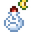

# China

<!-- Generado por tools/model-gen/make_codex.py desde los datos del mod. No editar a mano. -->

Los tesoros chinos vienen de los mitos antiguos (Nüwa, Hou Yi y Chang'e) y de dos novelas del siglo XVI que fijaron la imagen de dioses y demonios: Viaje al Oeste, con el Rey Mono, y La investidura de los dioses, con Nezha.  
Los dragones chinos (long) no tienen alas ni escupen fuego: vuelan entre las nubes y traen la lluvia.

| | Reliquia | Espacio | Rareza | Dónde |
|---|---|---|---|---|
|  | [Ruyi Jingu Bang](#ruyi-jingu-bang) | mano (arma) | épica | Ruinas submarinas grandes: 4 % por cofre |
|  | [Pelos del Rey Mono](#monkey-king-hairs) | mano | épica | Templos de la jungla: 4 % por cofre |
|  | [Calabaza roja de oro púrpura](#purple-gold-gourd) | mano | épica | Mazmorras: 3 % por cofre |
|  | [Abanico de hoja de plátano](#banana-leaf-fan) | mano (arma) | épica | Portales en ruinas: 4 % por cofre |
|  | [Perla del dragón](#dragon-pearl) | mano | épica | Ruinas submarinas chicas: 3 % por cofre; Arena sospechosa de ruinas oceánicas cálidas: 1 % por bloque cepillado |
|  | [Ruedas de viento y fuego](#wind-fire-wheels) | zapatos | épica | Tesoros de bastiones: 5 % por cofre |
|  | [Arco de Hou Yi](#hou-yi-bow) | mano (arma) | épica | Fortalezas del Nether: 4 % por cofre |
|  | [Elixir de Chang'e](#change-elixir) | mano | épica | Ciudades del End: 3 % por cofre |
|  | [Piedra de cinco colores](#five-color-stone) | cinturón | rara | Arena y grava sospechosas comunes de ruinas de los senderos: 1 % por bloque cepillado |

## Ruyi Jingu Bang

**Espacio:** mano (arma) · **Rareza:** épica

- Arma pesada con 1.5 bloques más de alcance
- Clic derecho: se estira 10 bloques en línea recta y golpea a todo con 10 de daño
- Recarga: 8 s

**Mito.** El bastón del Rey Mono. Era la columna de hierro con que el Rey Dragón del Mar del Este medía la profundidad del océano; pesaba 13.500 jin y obedecía a Sun Wukong.  
Crecía hasta el cielo o se encogía hasta caber detrás de su oreja. Es de hierro negro con un aro de oro en cada punta.

**Dónde encontrarla.** **Ruinas submarinas grandes**: 4 % por cofre

## Pelos del Rey Mono

**Espacio:** mano · **Rareza:** épica

- Clic derecho: soplas los pelos y salen 4 monos guerreros durante 60 s
- Pelean contra lo que golpeas o lo que te golpea: 20 de vida y 5 de daño cada uno
- Recarga: 4 min

**Mito.** Sun Wukong se arrancaba un puñado de pelos, los masticaba, los soplaba y gritaba «¡Cambia!»: cada pelo se volvía un mono igual a él que peleaba a su lado.  
Así enfrentó solo a los ejércitos del Cielo.

**Dónde encontrarla.** **Templos de la jungla**: 4 % por cofre

## Calabaza roja de oro púrpura

**Espacio:** mano · **Rareza:** épica

- Clic derecho a un mob: lo atrapas dentro (40 de vida o menos; no jefes, jugadores ni invocaciones)
- Clic derecho otra vez: lo sueltas donde miras
- Un hostil que pasa 5 min dentro se disuelve: te da su botín y su experiencia
- Recarga: 20 s

**Mito.** El tesoro de los demonios Cuerno de Oro y Cuerno de Plata en Viaje al Oeste. Si la calabaza decía tu nombre y respondías, quedabas atrapado dentro, y a las pocas horas te disolvías. Wukong cayó en ella y escapó con un engaño.  
Su nombre, zijin hong hulu, es «calabaza roja de oro púrpura»: el oro púrpura es un oro rojizo, no el color morado.

**Dónde encontrarla.** **Mazmorras**: 3 % por cofre

## Abanico de hoja de plátano

**Espacio:** mano (arma) · **Rareza:** épica

- Cada golpe lanza una cuchilla de viento: 12 bloques, 4 de daño a lo que cruza
- Clic derecho: un aleteo, un dash de viento de unos 10 bloques que empuja a los mobs
- 3 aleteos; cada uno vuelve en 6 s
- Tres aleteos en 4 s: nubes y lluvia durante 15 s que apagan el fuego cercano

**Mito.** El abanico de la Princesa Abanico de Hierro. Un aleteo levantaba el viento, el segundo traía las nubes y el tercero la lluvia: así se apagaban las Montañas Llameantes.  
Con un solo aleteo mandó a Wukong volando a miles de leguas.

**Dónde encontrarla.** **Portales en ruinas**: 4 % por cofre

## Perla del dragón

**Espacio:** mano · **Rareza:** épica

- Clic derecho: llamas a tu long, el dragón chino, y lo montas
- Vuela hacia donde miras (salto para subir) y nada bajo el agua; montado respiras bajo el agua
- Montado, usar la perla llama a la lluvia o la detiene
- Al bajarte vuelve a las nubes a los 3 s; si muere, vuelve en 5 min

**Mito.** Los dragones chinos (long) no escupen fuego ni tienen alas: vuelan entre las nubes, traen la lluvia y gobiernan los mares y los ríos.  
Tienen cuernos de ciervo, cuello de serpiente, escamas de carpa y garras de águila, y en el arte persiguen una perla llameante, fuente de su poder.

**Dónde encontrarla.** **Ruinas submarinas chicas**: 3 % por cofre; **Arena sospechosa de ruinas oceánicas cálidas**: 1 % por bloque cepillado

## Ruedas de viento y fuego

**Espacio:** zapatos · **Rareza:** épica

- +40% de velocidad y subes bloques de un paso
- Corriendo: estela de llamas que quema a los hostiles y el fuego no te daña
- Corriendo, cruzas la lava como si fuera suelo

**Mito.** Las ruedas de Nezha, el niño guerrero de La investidura de los dioses: dos ruedas que giraban entre viento y llamas bajo sus pies y lo llevaban volando a toda velocidad.

**Dónde encontrarla.** **Tesoros de bastiones**: 5 % por cofre

## Arco de Hou Yi

**Espacio:** mano (arma) · **Rareza:** épica

- Flechas con +50% de daño que vuelan más rápido y más recto
- Contra blazes, ghasts, cubos de magma, phantoms y vex: daño x3
- Lo que derribas así cae como un cuervo dorado y suelta el doble de botín

**Mito.** Cuando diez soles salieron juntos y quemaban la Tierra, el arquero Hou Yi derribó nueve con su arco rojo y sus flechas blancas, regalo del emperador del cielo.  
Cada sol era un cuervo dorado de tres patas, que cayó a tierra.

**Dónde encontrarla.** **Fortalezas del Nether**: 4 % por cofre

## Elixir de Chang'e

**Espacio:** mano · **Rareza:** épica

- Beber: ascenso lunar, saltas muy alto y caes despacio sin daño
- Tus golpes en el aire hacen +50% de daño
- Dura 30 s con luna llena, 20 s en cuarto y 10 s en luna nueva
- No se gasta. Recarga: 3 min

**Mito.** La Reina Madre del Oeste le dio a Hou Yi el elixir de la inmortalidad. Su esposa Chang'e se lo bebió, se volvió ligera y flotó hasta la Luna, donde vive todavía con el Conejo de Jade.

**Dónde encontrarla.** **Ciudades del End**: 3 % por cofre

## Piedra de cinco colores

**Espacio:** cinturón · **Rareza:** rara

- Cada 10 s repara 1 punto de durabilidad de la armadura y de lo que tienes en las manos
- Los rayos no te hacen daño

**Mito.** Cuando el pilar del cielo se rompió y el firmamento se agrietó, la diosa Nüwa fundió piedras de cinco colores y con ellas lo remendó.  
Una de las que sobraron es la piedra de «Sueño en el pabellón rojo».

**Dónde encontrarla.** **Arena y grava sospechosas comunes de ruinas de los senderos**: 1 % por bloque cepillado
