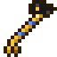
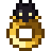
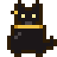
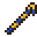
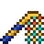
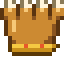

# Egipto

<!-- Generado por tools/model-gen/make_codex.py desde los datos del mod. No editar a mano. -->

Las reliquias no se fabrican: se encuentran. Las de Egipto descansan en los cofres de las pirámides del desierto, y alguna rara vez en las casas de sus aldeas.  
Mientras más poderosa la reliquia, más difícil es dar con ella.

| | Reliquia | Espacio | Rareza | Dónde |
|---|---|---|---|---|
|  | [Escarabajo dorado](#golden-scarab) | cinturón | rara | Pirámides del desierto: 3.5 % por cofre (≈ 13.3 % por pirámide) |
|  | [Ojo de Horus](#eye-of-horus) | cara | rara | Pirámides del desierto: 2.5 % por cofre (≈ 9.6 % por pirámide) |
|  | [Anj](#ankh) | collar | poco común | Pirámides del desierto: 3 % por cofre (≈ 11.5 % por pirámide); Casas de aldeas del desierto: 3 % por cofre |
|  | [Vendas de momia](#mummy-wraps) | guantes | poco común | Pirámides del desierto: 4 % por cofre (≈ 15.1 % por pirámide) |
|  | [Cetro was de Anubis](#anubis-scepter) | mano (arma) | épica | Pirámides del desierto: 2 % por cofre (≈ 7.8 % por pirámide) |
|  | [Máscara de chacal](#jackal-mask) | cara | rara | Pirámides del desierto: 3 % por cofre (≈ 11.5 % por pirámide) |
|  | [Anillo de los chacales](#jackal-ring) | anillo | rara | Pirámides del desierto: 2.5 % por cofre (≈ 9.6 % por pirámide) |
|  | [Disco solar de Ra](#ra-disk) | sombrero | épica | Arena sospechosa de pirámides del desierto: 1.5 % por bloque cepillado |
|  | [Amuleto de Bastet](#bastet-amulet) | collar | rara | Arena sospechosa de pozos del desierto: 5 % por bloque cepillado; Casas de aldeas del desierto: 4 % por cofre |
|  | [Paleta de escriba de Thot](#thoth-palette) | mano secundaria | rara | Arena sospechosa de pirámides del desierto: 3 % por bloque cepillado |
|  | [Cayado de Osiris](#osiris-crook) | mano secundaria | épica | Pirámides del desierto: 2 % por cofre (≈ 7.8 % por pirámide) |
|  | [Mayal de Osiris](#osiris-flail) | mano (arma) | épica | Pirámides del desierto: 2 % por cofre (≈ 7.8 % por pirámide) |
|  | [Garras de Sekhmet](#sekhmet-claws) | guantes | épica | Arena sospechosa de pirámides del desierto: 1.5 % por bloque cepillado |

## Escarabajo dorado

**Espacio:** cinturón · **Rareza:** rara

- Al bajar de 3 corazones, Jepri te hace renacer
- Absorción II y dos escarabajos aliados por 15 s
- Recarga: 60 s

**Mito.** Jepri, el dios escarabajo, empujaba el sol por el cielo como el escarabajo pelotero empuja su bola, y lo hacía renacer cada mañana.  
Los egipcios llevaban amuletos de escarabajo como símbolo de renacimiento y protección.

**Dónde encontrarla.** **Pirámides del desierto**: 3.5 % por cofre (≈ 13.3 % por pirámide)

## Ojo de Horus

**Espacio:** cara · **Rareza:** rara

- Inmune a Ceguera y Oscuridad
- Tras un golpe de 4 corazones o más, recuperas el 50% del daño en 5 s
- Recarga: 45 s

**Mito.** En su lucha por el trono, Set le arrancó un ojo a Horus, y Thot lo sanó.  
El wedjat, el ojo restaurado, se volvió el amuleto de la protección, la sanación y la plenitud.

**Dónde encontrarla.** **Pirámides del desierto**: 2.5 % por cofre (≈ 9.6 % por pirámide)

## Anj

**Espacio:** collar · **Rareza:** poco común

- Cura medio corazón cada 2.5 s
- Los no-muertos te hacen 25% menos daño

**Mito.** La llave de la vida. Los dioses aparecen acercándolo a la nariz de los faraones para darles el aliento de la vida eterna.

**Dónde encontrarla.** **Pirámides del desierto**: 3 % por cofre (≈ 11.5 % por pirámide); **Casas de aldeas del desierto**: 3 % por cofre

## Vendas de momia

**Espacio:** guantes · **Rareza:** poco común

- Tus golpes dan Hambre II (5 s) y Lentitud (3 s)
- Los husks no te atacan

**Mito.** Los embalsamadores envolvían el cuerpo en cientos de metros de lino para preservarlo en la otra vida.  
Los husks del desierto reconocen esas vendas como propias.

**Dónde encontrarla.** **Pirámides del desierto**: 4 % por cofre (≈ 15.1 % por pirámide)

## Cetro was de Anubis

**Espacio:** mano (arma) · **Rareza:** épica

- Juicio: el no-muerto con menos del 25% de vida se destruye de un golpe y suelta 2 veces la experiencia

*Set de Anubis (máscara, anillo y cetro):* Los no-muertos no te atacan salvo que los ataques primero

**Mito.** El cetro *was*, rematado por la cabeza de un animal y con la base en horquilla, lo llevaban los dioses como símbolo de poder.  
En la Sala de las Dos Verdades, Anubis pesaba el corazón del difunto contra la pluma de Maat: ese es su juicio.

**Dónde encontrarla.** **Pirámides del desierto**: 2 % por cofre (≈ 7.8 % por pirámide)

## Máscara de chacal

**Espacio:** cara · **Rareza:** rara

- Los no-muertos que matas sueltan un alma
- Al tocarla recuperas 1 ❤ (dura 10 s)

*Set de Anubis (máscara, anillo y cetro):* Los no-muertos no te atacan salvo que los ataques primero

**Mito.** Anubis guiaba a las almas de los muertos hasta el juicio. Los sacerdotes que embalsamaban usaban máscaras de chacal para encarnarlo.

**Dónde encontrarla.** **Pirámides del desierto**: 3 % por cofre (≈ 11.5 % por pirámide)

## Anillo de los chacales

**Espacio:** anillo · **Rareza:** rara

- De noche o bajo tierra, al recibir un golpe acuden 2 chacales aliados por 20 s
- Recarga: 90 s

*Set de Anubis (máscara, anillo y cetro):* Los no-muertos no te atacan salvo que los ataques primero

**Mito.** Los chacales rondaban los cementerios del desierto. Por eso los egipcios hicieron de Anubis, el dios con cabeza de chacal, el guardián de las tumbas.

**Dónde encontrarla.** **Pirámides del desierto**: 2.5 % por cofre (≈ 9.6 % por pirámide)

## Disco solar de Ra

**Espacio:** sombrero · **Rareza:** épica

- Bajo el sol, +30% de daño a los no-muertos y los prendes fuego 5 s
- Ureo: quien te golpea cuerpo a cuerpo arde 3 s
- Recarga del ureo: 10 s. De noche solo queda el ureo

**Mito.** Ra, dios del sol, cruza el cielo de día en su barca y de noche atraviesa la Duat, el inframundo, donde lucha contra Apep, la serpiente del caos.  
Sobre su cabeza lleva el disco solar rodeado por el ureo, la cobra que escupe fuego contra sus enemigos.

**Dónde encontrarla.** **Arena sospechosa de pirámides del desierto**: 1.5 % por bloque cepillado

## Amuleto de Bastet

**Espacio:** collar · **Rareza:** rara

- Los creepers y los phantoms te evitan, como a un gato
- Caes de pie: las caídas no te hacen daño

**Mito.** Bastet, la diosa gata, protegía el hogar, a las madres y a los niños. Los egipcios veneraban a los gatos porque cazaban serpientes y ratas.  
Al principio, Bastet era una leona guerrera, como Sekhmet.

**Dónde encontrarla.** **Arena sospechosa de pozos del desierto**: 5 % por bloque cepillado; **Casas de aldeas del desierto**: 4 % por cofre

## Paleta de escriba de Thot

**Espacio:** mano secundaria · **Rareza:** rara

- Clic derecho: escribes un nivel de tu experiencia
- Agachado y clic derecho: lo lees de vuelta
- Caben 1395 puntos (los niveles 0 a 30) y no se pierden al morir
- En la mano secundaria: +20% de experiencia

**Mito.** Thot, el dios ibis de la escritura, la sabiduría y la luna, era el escriba de los dioses: inventó los jeroglíficos y en el juicio de los muertos anota el peso del corazón.  
Los escribas escribían con cálamos y tinta roja y negra, que guardaban en su paleta.

**Dónde encontrarla.** **Arena sospechosa de pirámides del desierto**: 3 % por bloque cepillado

## Cayado de Osiris

**Espacio:** mano secundaria · **Rareza:** épica

- Los animales de granja te siguen
- Clic derecho en una cría: la vuelve adulta
- Recarga: 30 s

*Insignias de Osiris (cayado y mayal en las manos):* Al recibir daño mortal renaces con 4 ❤ y Regeneración II. Recarga: 20 min (un día de Minecraft)

**Mito.** Osiris, rey de Egipto, fue asesinado por su hermano Set y devuelto a la vida por Isis. Se volvió señor del más allá y dios de la agricultura y de la crecida del Nilo.  
El cayado, del pastor que guía, es una de las insignias del faraón.

**Dónde encontrarla.** **Pirámides del desierto**: 2 % por cofre (≈ 7.8 % por pirámide)

## Mayal de Osiris

**Espacio:** mano (arma) · **Rareza:** épica

- Ataque cargado giratorio: golpea a todos a 2.5 bloques con el 60% del daño
- Golpear un cultivo maduro trilla un 3×3 y lo vuelve a plantar

*Insignias de Osiris (cayado y mayal en las manos):* Al recibir daño mortal renaces con 4 ❤ y Regeneración II. Recarga: 20 min (un día de Minecraft)

**Mito.** El mayal es la otra insignia del faraón. Su origen se discute: herramienta para trillar el grano, espantamoscas de pastor o utensilio para recoger resina.  
Junto al cayado, simboliza el poder y la abundancia que Osiris traía con el Nilo.

**Dónde encontrarla.** **Pirámides del desierto**: 2 % por cofre (≈ 7.8 % por pirámide)

## Garras de Sekhmet

**Espacio:** guantes · **Rareza:** épica

- Frenesí: cada muerte antes de 5 s suma un nivel (máx. 3)
- +10% de daño y de velocidad por nivel
- Con frenesí 3, tus golpes queman 3 s
- Al calmarte, recuperas 2 ❤

**Mito.** Sekhmet, la leona de la guerra, «la Poderosa». Ra la envió a castigar a los humanos y entró en un frenesí de sangre; solo la detuvieron llenando los campos de cerveza teñida de rojo, que bebió creyendo que era sangre.  
También era diosa de la sanación, y se decía que su aliento era el viento caliente del desierto.

**Dónde encontrarla.** **Arena sospechosa de pirámides del desierto**: 1.5 % por bloque cepillado

## Set de Anubis

Set de Anubis (máscara, anillo y cetro): Los no-muertos no te atacan salvo que los ataques primero

**Mito.** Quien lleva la máscara y el anillo y carga el cetro es reconocido como servidor de Anubis: los muertos no lo atacan mientras no los perturbe.

## Insignias de Osiris

Insignias de Osiris (cayado y mayal en las manos): Al recibir daño mortal renaces con 4 ❤ y Regeneración II. Recarga: 20 min (un día de Minecraft)

**Mito.** Osiris es el dios que murió y volvió a la vida. Quien lleva sus dos insignias comparte un poco de ese renacer.
