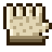

# Egipto

<!-- Generado por tools/model-gen/make_codex.py desde los datos del mod. No editar a mano. -->

Las reliquias no se fabrican: se encuentran. Las de Egipto descansan en los cofres de las pirámides del desierto, y alguna rara vez en las casas de sus aldeas.  
Mientras más poderosa la reliquia, más difícil es dar con ella.

| | Reliquia | Espacio | Rareza | Dónde |
|---|---|---|---|---|
|  | [Escarabajo dorado](#golden-scarab) | cinturón | rara | Pirámides del desierto: 3.5 % por cofre (≈ 13.3 % por pirámide) |
|  | [Ojo de Horus](#eye-of-horus) | cara | rara | Pirámides del desierto: 2.5 % por cofre (≈ 9.6 % por pirámide) |
|  | [Anj](#ankh) | collar | poco común | Pirámides del desierto: 3 % por cofre (≈ 11.5 % por pirámide); Casas de aldeas del desierto: 3 % por cofre |
|  | [Vendas de momia](#mummy-wraps) | guantes | poco común | Pirámides del desierto: 4 % por cofre (≈ 15.1 % por pirámide) |
|  | [Cetro was de Anubis](#anubis-scepter) | mano (arma) | épica | Pirámides del desierto: 2 % por cofre (≈ 7.8 % por pirámide) |
|  | [Máscara de chacal](#jackal-mask) | cara | rara | Pirámides del desierto: 3 % por cofre (≈ 11.5 % por pirámide) |
|  | [Anillo de los chacales](#jackal-ring) | anillo | rara | Pirámides del desierto: 2.5 % por cofre (≈ 9.6 % por pirámide) |

## Escarabajo dorado

**Espacio:** cinturón · **Rareza:** rara

- Al bajar de 3 corazones, Jepri te hace renacer
- Absorción II y dos escarabajos aliados por 15 s
- Recarga: 60 s

**Mito.** Jepri, el dios escarabajo, empujaba el sol por el cielo como el escarabajo pelotero empuja su bola, y lo hacía renacer cada mañana.  
Los egipcios llevaban amuletos de escarabajo como símbolo de renacimiento y protección.

**Dónde encontrarla.** **Pirámides del desierto**: 3.5 % por cofre (≈ 13.3 % por pirámide)

## Ojo de Horus

**Espacio:** cara · **Rareza:** rara

- Inmune a Ceguera y Oscuridad
- Tras un golpe de 4 corazones o más, recuperas el 50% del daño en 5 s
- Recarga: 45 s

**Mito.** En su lucha por el trono, Set le arrancó un ojo a Horus, y Thot lo sanó.  
El wedjat, el ojo restaurado, se volvió el amuleto de la protección, la sanación y la plenitud.

**Dónde encontrarla.** **Pirámides del desierto**: 2.5 % por cofre (≈ 9.6 % por pirámide)

## Anj

**Espacio:** collar · **Rareza:** poco común

- Cura medio corazón cada 2.5 s
- Los no-muertos te hacen 25% menos daño

**Mito.** La llave de la vida. Los dioses aparecen acercándolo a la nariz de los faraones para darles el aliento de la vida eterna.

**Dónde encontrarla.** **Pirámides del desierto**: 3 % por cofre (≈ 11.5 % por pirámide); **Casas de aldeas del desierto**: 3 % por cofre

## Vendas de momia

**Espacio:** guantes · **Rareza:** poco común

- Tus golpes dan Hambre II (5 s) y Lentitud (3 s)
- Los husks no te atacan

**Mito.** Los embalsamadores envolvían el cuerpo en cientos de metros de lino para preservarlo en la otra vida.  
Los husks del desierto reconocen esas vendas como propias.

**Dónde encontrarla.** **Pirámides del desierto**: 4 % por cofre (≈ 15.1 % por pirámide)

## Cetro was de Anubis

**Espacio:** mano (arma) · **Rareza:** épica

- Juicio: el no-muerto con menos del 25% de vida se destruye de un golpe y suelta 2 veces la experiencia

*Set de Anubis (máscara, anillo y cetro):* Los no-muertos no te atacan salvo que los ataques primero

**Mito.** El cetro *was*, rematado por la cabeza de un animal y con la base en horquilla, lo llevaban los dioses como símbolo de poder.  
En la Sala de las Dos Verdades, Anubis pesaba el corazón del difunto contra la pluma de Maat: ese es su juicio.

**Dónde encontrarla.** **Pirámides del desierto**: 2 % por cofre (≈ 7.8 % por pirámide)

## Máscara de chacal

**Espacio:** cara · **Rareza:** rara

- Los no-muertos que matas sueltan un alma
- Al tocarla recuperas 1 ❤ (dura 10 s)

*Set de Anubis (máscara, anillo y cetro):* Los no-muertos no te atacan salvo que los ataques primero

**Mito.** Anubis guiaba a las almas de los muertos hasta el juicio. Los sacerdotes que embalsamaban usaban máscaras de chacal para encarnarlo.

**Dónde encontrarla.** **Pirámides del desierto**: 3 % por cofre (≈ 11.5 % por pirámide)

## Anillo de los chacales

**Espacio:** anillo · **Rareza:** rara

- De noche o bajo tierra, al recibir un golpe acuden 2 chacales aliados por 20 s
- Recarga: 90 s

*Set de Anubis (máscara, anillo y cetro):* Los no-muertos no te atacan salvo que los ataques primero

**Mito.** Los chacales rondaban los cementerios del desierto. Por eso los egipcios hicieron de Anubis, el dios con cabeza de chacal, el guardián de las tumbas.

**Dónde encontrarla.** **Pirámides del desierto**: 2.5 % por cofre (≈ 9.6 % por pirámide)

## Set de Anubis

Set de Anubis (máscara, anillo y cetro): Los no-muertos no te atacan salvo que los ataques primero

**Mito.** Quien lleva la máscara y el anillo y carga el cetro es reconocido como servidor de Anubis: los muertos no lo atacan mientras no los perturbe.
