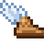
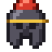
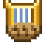
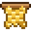

# Grecia

<!-- Generado por tools/model-gen/make_codex.py desde los datos del mod. No editar a mano. -->

Grecia no dejó pirámides: sus reliquias están donde su mito calza. Las ruinas antiguas se cepillan, el laberinto guarda el hilo, el Nether es el reino de Hades y la ciudad antigua, el descenso de Orfeo.  
Perseo armó su equipo con los regalos de los dioses para vencer a Medusa.

| | Reliquia | Espacio | Rareza | Dónde |
|---|---|---|---|---|
|  | [Sandalias aladas de Hermes](#hermes-sandals) | zapatos | épica | Arena y grava sospechosas de ruinas de los senderos: 2 % por bloque cepillado |
|  | [Yelmo de Hades](#hades-helm) | sombrero | épica | Fortalezas del Nether: 4 % por cofre |
|  | [Égida de Atenea](#athena-aegis) | espalda | rara | Recompensas de cámaras de desafío: 3 % por cofre |
|  | [Cabeza de Medusa](#medusa-head) | mano secundaria | épica | Arena sospechosa de ruinas oceánicas cálidas: 1.5 % por bloque cepillado |
|  | [Hilo de Ariadna](#ariadne-thread) | mano | rara | Pasillos de la fortaleza: 6 % por cofre; Bibliotecas de la fortaleza: 6 % por cofre |
|  | [Óbolo de Caronte](#charon-obol) | inventario | rara | Fortalezas del Nether: 5 % por cofre; Arena y grava sospechosas de ruinas de los senderos: 3 % por bloque cepillado |
|  | [Lira de Orfeo](#orpheus-lyre) | mano | épica | Ciudades antiguas: 3 % por cofre |
|  | [Alas de Ícaro](#icarus-wings) | espalda | épica | Grava sospechosa de ruinas oceánicas frías: 1.5 % por bloque cepillado |
|  | [Vellocino de oro](#golden-fleece) | capa | épica | Casas de pastor: 4 % por cofre; Tesoros de naufragios: 2 % por cofre |
|  | [Collar de Cerbero](#cerberus-collar) | collar | épica | Tesoros de bastiones: 3 % por cofre; Bastiones: 3 % por cofre; Puentes de bastiones: 3 % por cofre; Establos de hoglins: 3 % por cofre |
|  | [Jarra de Pandora](#pandora-jar) | mano | épica | Mansiones del bosque: 5 % por cofre |
|  | [Agua del Estigia](#styx-water) | mano | épica | Ciudades antiguas: 2 % por cofre |
|  | [Hinojo de Prometeo](#prometheus-fennel) | mano | rara | Portales en ruinas: 3 % por cofre |

## Sandalias aladas de Hermes

**Espacio:** zapatos · **Rareza:** épica

- +20% de velocidad y doble salto
- La arena y la tierra de almas no te frenan

*Set de Perseo (sandalias, yelmo y égida):* La cabeza de Medusa recarga a la mitad y lo petrificado recibe +50 % de daño

**Mito.** Hermes, mensajero de los dioses, volaba con sus sandalias aladas. También guiaba las almas de los muertos al inframundo.  
Se las prestó a Perseo para ir a buscar a Medusa.

**Dónde encontrarla.** **Arena y grava sospechosas de ruinas de los senderos**: 2 % por bloque cepillado

## Yelmo de Hades

**Espacio:** sombrero · **Rareza:** épica

- Agachado y quieto 2 s: te vuelves invisible y los mobs pierden tu rastro
- Correr, levantarte o atacar lo rompe

*Set de Perseo (sandalias, yelmo y égida):* La cabeza de Medusa recarga a la mitad y lo petrificado recibe +50 % de daño

**Mito.** Los cíclopes forjaron para Hades un yelmo que vuelve invisible a quien lo lleva.  
Atenea y Perseo también lo usaron; con él, Perseo escapó de las gorgonas.

**Dónde encontrarla.** **Fortalezas del Nether**: 4 % por cofre

## Égida de Atenea

**Espacio:** espalda · **Rareza:** rara

- Al bloquear con escudo un golpe cuerpo a cuerpo, el atacante queda aturdido 2 s y retrocede

*Set de Perseo (sandalias, yelmo y égida):* La cabeza de Medusa recarga a la mitad y lo petrificado recibe +50 % de daño

**Mito.** La égida, la piel de cabra de Zeus que llevaba Atenea, tenía el gorgoneion, el rostro de Medusa que aterraba a los enemigos.  
Atenea le dio a Perseo el escudo pulido para no mirar a Medusa.

**Dónde encontrarla.** **Recompensas de cámaras de desafío**: 3 % por cofre

## Cabeza de Medusa

**Espacio:** mano secundaria · **Rareza:** épica

- Clic derecho: petrifica 5 s a los hostiles que tienes delante hasta 16 bloques (no a los jefes). Si mueren así se derrumban: doble botín y a veces su estatua
- Recarga: 60 s

**Mito.** Medusa, la gorgona, convertía en piedra a quien la miraba.  
Perseo la decapitó mirándola en el reflejo del escudo de Atenea, y usó su cabeza como arma.

**Dónde encontrarla.** **Arena sospechosa de ruinas oceánicas cálidas**: 1.5 % por bloque cepillado

## Hilo de Ariadna

**Espacio:** mano · **Rareza:** rara

- Clic derecho: atas el hilo donde estás
- Agachado y clic derecho: vuelves al inicio
- Misma dimensión, hasta 256 bloques. Recarga: 5 min

**Mito.** Ariadna le dio a Teseo un ovillo de hilo para entrar al laberinto del Minotauro y encontrar la salida.

**Dónde encontrarla.** **Pasillos de la fortaleza**: 6 % por cofre; **Bibliotecas de la fortaleza**: 6 % por cofre

## Óbolo de Caronte

**Espacio:** inventario · **Rareza:** rara

- Si mueres con él en el inventario, pagas el pasaje: conservas el inventario y la experiencia
- El óbolo se gasta

**Mito.** Los griegos ponían un óbolo en la boca de sus muertos para pagarle a Caronte el cruce hacia el Hades. Sin pago, el alma vagaba cien años en la orilla.  
El de Atenas llevaba la lechuza de Atenea.

**Dónde encontrarla.** **Fortalezas del Nether**: 5 % por cofre; **Arena y grava sospechosas de ruinas de los senderos**: 3 % por bloque cepillado

## Lira de Orfeo

**Espacio:** mano · **Rareza:** épica

- Mantén clic derecho para tocar: los animales a 16 bloques te siguen y los hostiles a 8 bloques se duermen (no los jefes)

**Mito.** La música de Orfeo encantaba a animales, árboles y piedras.  
Bajó al inframundo por Eurídice y con su lira conmovió a Hades y adormeció a sus guardianes.

**Dónde encontrarla.** **Ciudades antiguas**: 3 % por cofre

## Alas de Ícaro

**Espacio:** espalda · **Rareza:** épica

- En el aire, mantén salto para planear
- Hasta 3 aleteos por vuelo (se recargan en el suelo)
- Sobre la altura 150, de día y bajo el cielo, la cera se derrite: 30 s sin alas

**Mito.** Dédalo, el arquitecto del laberinto, hizo alas de plumas pegadas con cera para escapar de Creta con su hijo Ícaro.  
Le advirtió que no volara muy alto, porque el sol derrite la cera, ni muy bajo, porque el mar moja las plumas. Ícaro subió demasiado y cayó al mar.

**Dónde encontrarla.** **Grava sospechosa de ruinas oceánicas frías**: 1.5 % por bloque cepillado

## Vellocino de oro

**Espacio:** capa · **Rareza:** épica

- Rey legítimo: Héroe de la aldea mientras lo llevas
- Al esquilar, 10% de que caiga una pepita de oro

**Mito.** Es la piel del carnero alado de oro Crisómalo, colgada de un roble en la Cólquide y vigilada por un dragón que nunca dormía.  
Jasón y los argonautas la buscaron porque traerla era la prueba para reclamar el trono: era el símbolo del rey legítimo.

**Dónde encontrarla.** **Casas de pastor**: 4 % por cofre; **Tesoros de naufragios**: 2 % por cofre

## Collar de Cerbero

**Espacio:** collar · **Rareza:** épica

- Cuando un mob te hiere, aparece Cerbero que lo ataca durante 20 s: 3 mordidas por ataque
- En el Nether, sus mordidas prenden fuego 3 s
- Recarga: 60 s

**Mito.** Cerbero, el perro de tres cabezas, guardaba la puerta del Hades: dejaba entrar a los muertos y no dejaba salir a nadie.  
Capturarlo fue el último de los doce trabajos de Heracles, que lo sacó encadenado.

**Dónde encontrarla.** **Tesoros de bastiones**: 3 % por cofre; **Bastiones**: 3 % por cofre; **Puentes de bastiones**: 3 % por cofre; **Establos de hoglins**: 3 % por cofre

## Jarra de Pandora

**Espacio:** mano · **Rareza:** épica

- Clic derecho: abres la jarra y tiras al azar
- 40%: un mal sobre ti durante 10 s
- 25%: escapan 3 vexes que te atacan 20 s
- 25%: un tesoro
- 10%: la Esperanza te cura y te da absorción 2 min
- Recarga: 90 s

**Mito.** Zeus le dio a Pandora, la primera mujer, una jarra que no debía abrir. Al abrirla salieron todos los males del mundo; solo la Esperanza quedó dentro.  
Era un pithos, una jarra: la «caja» viene de una mala traducción.

**Dónde encontrarla.** **Mansiones del bosque**: 5 % por cofre

## Agua del Estigia

**Espacio:** mano · **Rareza:** épica

- Bébela: durante 3 min recibes el 50% del daño de frente y de costado
- Talón: por la espalda recibes el doble
- No se gasta. Recarga: 10 min

**Mito.** Tetis sumergió a su hijo Aquiles en el río Estigia para hacerlo invulnerable. Lo sostuvo del talón, que quedó sin mojar.  
En Troya, Paris lo mató con una flecha en el talón.

**Dónde encontrarla.** **Ciudades antiguas**: 2 % por cofre

## Hinojo de Prometeo

**Espacio:** mano · **Rareza:** rara

- Lo que golpeas arde 4 s
- Clic derecho: cocina o funde al instante el stack entero de la otra mano
- Recarga: 1 s por objeto (mínimo 5 s)

**Mito.** El titán Prometeo robó el fuego de los dioses escondiendo una brasa en un tallo hueco de hinojo, y se lo dio a los humanos junto con las artes.  
Zeus lo encadenó a una roca, donde un águila le comía el hígado cada día.

**Dónde encontrarla.** **Portales en ruinas**: 3 % por cofre

## Set de Perseo

Set de Perseo (sandalias, yelmo y égida): La cabeza de Medusa recarga a la mitad y lo petrificado recibe +50 % de daño

**Mito.** Con las sandalias de Hermes, el yelmo de Hades y el escudo de Atenea, Perseo pudo acercarse a Medusa sin ser visto, sin mirarla y escapar volando.
