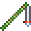
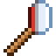
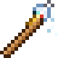
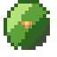

# Japón

<!-- Generado por tools/model-gen/make_codex.py desde los datos del mod. No editar a mano. -->

Los mitos japoneses vienen del Kojiki y del Nihon Shoki, del siglo VIII: Amaterasu, la diosa del sol; su hermano Susanoo, que mató a la serpiente de ocho cabezas; y los Tres Tesoros Imperiales, insignias de los emperadores hasta hoy.  
A eso se suman los dioses del trueno y del mar y el folclore: los kitsune, los oni, Issun-bōshi, Momotarō y Urashima Tarō.

| | Reliquia | Espacio | Rareza | Dónde |
|---|---|---|---|---|
|  | [Kusanagi no Tsurugi](#kusanagi) | mano (arma) | épica | Bóvedas ominosas de cámaras de desafío: 2 % por cofre |
|  | [Yata no Kagami](#yata-mirror) | mano secundaria | épica | Ciudades antiguas: 3 % por cofre |
|  | [Yasakani no Magatama](#yasakani-magatama) | collar | épica | Arena y grava sospechosas de ruinas de los senderos: 1.5 % por bloque cepillado |
|  | [Tambor de Raijin](#raijin-drum) | espalda | épica | Recompensas de cámaras de desafío: 3 % por cofre |
|  | [Kanabō del oni](#oni-kanabo) | mano (arma) | épica | Puentes de bastiones: 3 % por cofre |
|  | [Esfera estelar del kitsune](#kitsune-star-ball) | mano | épica | Casas de aldeas de taiga: 3 % por cofre |
|  | [Joyas de la marea](#tide-jewels) | mano | épica | Ruinas submarinas grandes: 3 % por cofre |
|  | [Mazo de la suerte](#lucky-mallet) | mano | épica | Tesoros enterrados: 3 % por cofre |
|  | [Kibi dango de Momotarō](#kibi-dango) | mano | rara | Casas de aldeas de llanura: 4 % por cofre |
|  | [Caña de Urashima](#urashima-rod) | mano | épica | Tesoros de naufragios: 3 % por cofre |
|  | [Bolsa de vientos de Fūjin](#fujin-wind-bag) | mano | épica | Recompensas de cámaras de desafío: 3 % por cofre |
|  | [Máscara de tengu](#tengu-mask) | cara | épica | Puestos de saqueadores: 3 % por cofre |
|  | [Sake de Yashiori](#yashiori-sake) | mano | rara | Provisiones de naufragios: 3 % por cofre |
|  | [Plato del kappa](#kappa-dish) | sombrero | rara | Ruinas submarinas chicas: 3 % por cofre |
|  | [Hoja del tanuki](#tanuki-leaf) | mano | rara | Mansiones del bosque: 3 % por cofre |
|  | [Hacha de Kintarō](#kintaro-axe) | mano (arma) | épica | Herrerías de herramientas de aldea: 4 % por cofre |
|  | [Muñeca de zashiki-warashi](#zashiki-warashi) | bloque (se coloca) | épica | Casas de aldeas nevadas: 3 % por cofre |
|  | [Ame-no-nuboko](#ame-no-nuboko) | mano | épica | Mapas de naufragios: 3 % por cofre |
|  | [Escama de Yamata no Orochi](#orochi-scale) | mano | épica | Ciudades antiguas: 2 % por cofre |

## Kusanagi no Tsurugi

**Espacio:** mano (arma) · **Rareza:** épica

- Clic derecho: tajo de viento en arco de 5 bloques, 16 de daño y empuje
- Siega la hierba y apaga el fuego que alcanza
- Recarga: 5 s

**Mito.** La espada que Susanoo encontró dentro de la cola de Yamata no Orochi, la serpiente de ocho cabezas.  
Su nombre, «cortadora de hierba», viene de Yamato Takeru: atrapado en un campo en llamas, segó la hierba con ella y el viento volvió el fuego contra sus enemigos.

**Dónde encontrarla.** **Bóvedas ominosas de cámaras de desafío**: 2 % por cofre

## Yata no Kagami

**Espacio:** mano secundaria · **Rareza:** épica

- En la mano secundaria: las flechas y bolas de fuego rebotan hacia quien las lanzó
- Clic derecho: un destello de sol ciega a los hostiles a 12 bloques durante 5 s
- Recarga: 30 s

**Mito.** El espejo de bronce que los dioses colgaron frente a la cueva donde se había encerrado Amaterasu, la diosa del sol.  
Al asomarse, ella vio su propio brillo reflejado y salió: la luz volvió al mundo.

**Dónde encontrarla.** **Ciudades antiguas**: 3 % por cofre

## Yasakani no Magatama

**Espacio:** collar · **Rareza:** épica

- De día y bajo el cielo recuperas medio corazón cada 5 s

**Mito.** La joya curva de jade que colgaba del árbol frente a la cueva de Amaterasu, junto al espejo.  
Es la tercera insignia imperial y simboliza el alma y la bondad del linaje del sol.

**Dónde encontrarla.** **Arena y grava sospechosas de ruinas de los senderos**: 1.5 % por bloque cepillado

## Tambor de Raijin

**Espacio:** espalda · **Rareza:** épica

- Cada 4 golpes seguidos cae un rayo sobre tu objetivo
- Entre golpe y golpe no deben pasar más de 3 s
- Los rayos no te hacen daño

**Mito.** Raijin, el dios del trueno, flota entre las nubes rodeado de un círculo de tambores taiko. Cada golpe de sus palillos es un trueno.

**Dónde encontrarla.** **Recompensas de cámaras de desafío**: 3 % por cofre

## Kanabō del oni

**Espacio:** mano (arma) · **Rareza:** épica

- Golpe de oni: ignora el 50% de la armadura del golpeado
- Muy lento y pesado

**Mito.** La maza de hierro con púas de los oni, los ogros del folclore.  
«Como un oni con su kanabō» se dice de quien ya era fuerte y además va armado: invencible.

**Dónde encontrarla.** **Puentes de bastiones**: 3 % por cofre

## Esfera estelar del kitsune

**Espacio:** mano · **Rareza:** épica

- Clic derecho: llamas a un kitsune de nueve colas durante 60 s
- 30 de vida y 6 de daño; cada 3 s lanza un kitsunebi que quema 2 s y confunde
- Recarga: 4 min

**Mito.** Los kitsune, zorros mágicos, ganan una cola cada cien años hasta tener nueve.  
Guardan su poder en una hoshi no tama, una esfera blanca con una llama, y encienden kitsunebi, fuegos fatuos azules.

**Dónde encontrarla.** **Casas de aldeas de taiga**: 3 % por cofre

## Joyas de la marea

**Espacio:** mano · **Rareza:** épica

- Kanju (clic derecho): una burbuja sin agua de 3 bloques te rodea y te sigue durante 20 s
- Manju (agachado): una ola que arrastra a los mobs 8 bloques y apaga el fuego
- Recarga: 60 s

**Mito.** Ryūjin, el Rey Dragón del mar, tenía dos joyas: kanju, que hacía bajar la marea, y manju, que la hacía subir.  
Se las prestó a la emperatriz Jingū para vencer a una flota enemiga.

**Dónde encontrarla.** **Ruinas submarinas grandes**: 3 % por cofre

## Mazo de la suerte

**Espacio:** mano · **Rareza:** épica

- Clic derecho: creces 1.6 veces durante 30 s, con más alcance y 4 corazones más
- Grande: más fuerza, saltas más alto, subes bloques sin saltar y te empujan menos
- Recarga: 3 min
- Agachado: los cultivos y crías a 4 bloques crecen al instante

**Mito.** El uchide no kozuchi, el mazo mágico de Daikokuten: al agitarlo da lo que se le pide.  
Con él, el diminuto Issun-bōshi creció hasta ser un hombre de tamaño normal.

**Dónde encontrarla.** **Tesoros enterrados**: 3 % por cofre

## Kibi dango de Momotarō

**Espacio:** mano · **Rareza:** rara

- Dásela a un lobo, zorro o loro salvaje: se vuelve tu compañero al instante
- Comer una: Fuerza I durante 60 s
- La bolsa tiene 3 y se rellena una por día

**Mito.** Momotarō, el niño que nació de un melocotón, salió a pelear contra los oni con una bolsa de kibi dango, bolitas de mijo.  
Con ellas se ganó como compañeros a un perro, un mono y un faisán.

**Dónde encontrarla.** **Casas de aldeas de llanura**: 4 % por cofre

## Caña de Urashima

**Espacio:** mano · **Rareza:** épica

- Clic derecho desde el agua: llamas a la tortuga gigante y la montas
- Nada muy rápido bajo el agua (salto para subir); montado respiras y ves bajo el agua
- Al bajarte vuelve al mar a los 3 s; si muere, vuelve en 5 min

**Mito.** Urashima Tarō, un pescador, salvó a una tortuga de unos niños que la maltrataban.  
Agradecida, la tortuga lo llevó sobre su caparazón al Ryūgū-jō, el palacio del Rey Dragón bajo el mar.

**Dónde encontrarla.** **Tesoros de naufragios**: 3 % por cofre

## Bolsa de vientos de Fūjin

**Espacio:** mano · **Rareza:** épica

- Clic derecho: una corriente te eleva y bajas planeando 6 s
- Agachado: un ventarrón empuja lejos todo lo que hay a 8 bloques
- Recarga: 20 s

**Mito.** Fūjin, el dios del viento, carga sobre los hombros un saco con todos los vientos del mundo y los suelta al abrirlo.  
Siempre aparece junto a Raijin, el dios del trueno, como en el famoso biombo de Tawaraya Sōtatsu.

**Dónde encontrarla.** **Recompensas de cámaras de desafío**: 3 % por cofre

## Máscara de tengu

**Espacio:** cara · **Rareza:** épica

- Salto de tengu: puedes saltar una vez más en el aire
- Esgrima de Kurama: tus golpes críticos hacen +50% de daño

**Mito.** Los tengu, duendes de las montañas de cara roja y nariz larga, son maestros de la espada y del vuelo.  
Según la leyenda, el rey tengu Sōjōbō enseñó esgrima al joven Minamoto no Yoshitsune en el monte Kurama.

**Dónde encontrarla.** **Puestos de saqueadores**: 3 % por cofre

## Sake de Yashiori

**Espacio:** mano · **Rareza:** rara

- Clic derecho: la jarra salpica sake a 4 bloques donde miras (hasta 12 bloques)
- Los mobs mojados quedan borrachos 10 s: lentos y mareados; los hostiles se atacan entre ellos
- Recarga: 60 s (la jarra se vuelve a llenar sola)

**Mito.** Para vencer a Yamata no Orochi, Susanoo hizo destilar ocho veces un sake muy fuerte y lo puso en ocho barricas.  
La serpiente metió una cabeza en cada una, se emborrachó y se durmió.

**Dónde encontrarla.** **Provisiones de naufragios**: 3 % por cofre

## Plato del kappa

**Espacio:** sombrero · **Rareza:** rara

- Bajo el agua nadas muy rápido y tus golpes hacen +30% de daño
- Tras 60 s al sol fuera del agua el plato se seca y pierdes el bono
- Vuelve a mojarse con agua o lluvia

**Mito.** Los kappa son yōkai de los ríos con un plato lleno de agua en la coronilla.  
Mientras el plato tenga agua son muy fuertes; si se derrama o se seca, se debilitan.

**Dónde encontrarla.** **Ruinas submarinas chicas**: 3 % por cofre

## Hoja del tanuki

**Espacio:** mano · **Rareza:** rara

- Clic derecho: te transformas y los hostiles no te ven durante 30 s
- Atacar deshace la transformación
- Recarga: 2 min

**Mito.** Los tanuki del folclore cambian de forma poniéndose una hoja en la cabeza.  
Se vuelven monjes, teteras o estatuas para engañar a la gente.

**Dónde encontrarla.** **Mansiones del bosque**: 3 % por cofre

## Hacha de Kintarō

**Espacio:** mano (arma) · **Rareza:** épica

- Agachado: al cortar un tronco cae el árbol entero (hasta 64 troncos)
- +50% de daño a osos polares, hoglins, ravagers y arañas
- Irrompible

**Mito.** Kintarō, el niño de oro, creció en el monte Ashigara con una fuerza sobrehumana: luchaba con osos y derribaba árboles con su masakari.  
De mayor fue el guerrero Sakata no Kintoki.

**Dónde encontrarla.** **Herrerías de herramientas de aldea**: 4 % por cofre

## Muñeca de zashiki-warashi

**Espacio:** bloque (se coloca) · **Rareza:** épica

- Colócala: los jugadores a 16 bloques tienen Suerte y los aldeanos les hacen mejores precios
- Si la rompes, la fortuna se va con ella

**Mito.** El zashiki-warashi es el espíritu de un niño que vive en algunas casas del norte de Japón.  
Mientras se queda, la familia prospera; el día que se va, la fortuna se va con él.

**Dónde encontrarla.** **Casas de aldeas nevadas**: 3 % por cofre

## Ame-no-nuboko

**Espacio:** mano · **Rareza:** épica

- Clic derecho mirando al agua (hasta 16 bloques): brota una islita de arena y pasto
- La isla mide 7 bloques de ancho
- Recarga: 30 s

**Mito.** La lanza enjoyada que los dioses entregaron a Izanagi e Izanami.  
Desde el puente flotante del cielo revolvieron con ella el mar, y de las gotas saladas que cayeron de la punta nació Onogoro, la primera isla.

**Dónde encontrarla.** **Mapas de naufragios**: 3 % por cofre

## Escama de Yamata no Orochi

**Espacio:** mano · **Rareza:** épica

- Clic derecho: surge una sombra de Orochi que se queda a tu lado 45 s
- Sus ocho cabezas muerden a los hostiles a 6 bloques (4 de daño cada una)
- Recarga: 5 min

**Mito.** Yamata no Orochi, la serpiente de ocho cabezas y ocho colas, tan larga que cubría ocho valles, con ojos rojos como cerezas de invierno.  
Devoraba cada año a una hija de una familia hasta que Susanoo la emborrachó con sake y la venció.

**Dónde encontrarla.** **Ciudades antiguas**: 2 % por cofre
