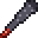
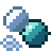
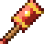
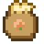

# Japón

<!-- Generado por tools/model-gen/make_codex.py desde los datos del mod. No editar a mano. -->

Los mitos japoneses vienen del Kojiki y del Nihon Shoki, del siglo VIII: Amaterasu, la diosa del sol; su hermano Susanoo, que mató a la serpiente de ocho cabezas; y los Tres Tesoros Imperiales, insignias de los emperadores hasta hoy.  
A eso se suman los dioses del trueno y del mar y el folclore: los kitsune, los oni, Issun-bōshi, Momotarō y Urashima Tarō.

| | Reliquia | Espacio | Rareza | Dónde |
|---|---|---|---|---|
|  | [Kusanagi no Tsurugi](#kusanagi) | mano (arma) | épica | Bóvedas ominosas de cámaras de desafío: 2 % por cofre |
|  | [Yata no Kagami](#yata-mirror) | mano secundaria | épica | Ciudades antiguas: 3 % por cofre |
|  | [Yasakani no Magatama](#yasakani-magatama) | collar | épica | Arena y grava sospechosas de ruinas de los senderos: 1.5 % por bloque cepillado |
|  | [Tambor de Raijin](#raijin-drum) | espalda | épica | Recompensas de cámaras de desafío: 3 % por cofre |
|  | [Kanabō del oni](#oni-kanabo) | mano (arma) | épica | Puentes de bastiones: 3 % por cofre |
|  | [Esfera estelar del kitsune](#kitsune-star-ball) | mano | épica | Casas de aldeas de taiga: 3 % por cofre |
|  | [Joyas de la marea](#tide-jewels) | mano | épica | Ruinas submarinas grandes: 3 % por cofre |
|  | [Mazo de la suerte](#lucky-mallet) | mano | épica | Tesoros enterrados: 3 % por cofre |
|  | [Kibi dango de Momotarō](#kibi-dango) | mano | rara | Casas de aldeas de llanura: 4 % por cofre |
|  | [Caña de Urashima](#urashima-rod) | mano | épica | Tesoros de naufragios: 3 % por cofre |

## Kusanagi no Tsurugi

**Espacio:** mano (arma) · **Rareza:** épica

- Clic derecho: tajo de viento en arco de 5 bloques, 6 de daño y empuje
- Siega la hierba y apaga el fuego que alcanza
- Recarga: 8 s. Parte del set de los Tres Tesoros

**Mito.** La espada que Susanoo encontró dentro de la cola de Yamata no Orochi, la serpiente de ocho cabezas.  
Su nombre, «cortadora de hierba», viene de Yamato Takeru: atrapado en un campo en llamas, segó la hierba con ella y el viento volvió el fuego contra sus enemigos.

**Dónde encontrarla.** **Bóvedas ominosas de cámaras de desafío**: 2 % por cofre

## Yata no Kagami

**Espacio:** mano secundaria · **Rareza:** épica

- En la mano secundaria: las flechas y bolas de fuego rebotan hacia quien las lanzó
- Clic derecho: un destello de sol ciega a los hostiles a 12 bloques durante 5 s
- Recarga: 30 s. Parte del set de los Tres Tesoros

**Mito.** El espejo de bronce que los dioses colgaron frente a la cueva donde se había encerrado Amaterasu, la diosa del sol.  
Al asomarse, ella vio su propio brillo reflejado y salió: la luz volvió al mundo.

**Dónde encontrarla.** **Ciudades antiguas**: 3 % por cofre

## Yasakani no Magatama

**Espacio:** collar · **Rareza:** épica

- De día y bajo el cielo recuperas medio corazón cada 5 s
- Set de los Tres Tesoros (Kusanagi en una mano, el espejo en la otra y la magatama puesta): de día +20% de daño y Resistencia I

**Mito.** La joya curva de jade que colgaba del árbol frente a la cueva de Amaterasu, junto al espejo.  
Es la tercera insignia imperial y simboliza el alma y la bondad del linaje del sol.

**Dónde encontrarla.** **Arena y grava sospechosas de ruinas de los senderos**: 1.5 % por bloque cepillado

## Tambor de Raijin

**Espacio:** espalda · **Rareza:** épica

- Cada 4 golpes seguidos cae un rayo sobre tu objetivo
- Entre golpe y golpe no deben pasar más de 3 s
- Los rayos no te hacen daño

**Mito.** Raijin, el dios del trueno, flota entre las nubes rodeado de un círculo de tambores taiko. Cada golpe de sus palillos es un trueno.

**Dónde encontrarla.** **Recompensas de cámaras de desafío**: 3 % por cofre

## Kanabō del oni

**Espacio:** mano (arma) · **Rareza:** épica

- Golpe de oni: ignora el 50% de la armadura del golpeado
- Muy lento y pesado

**Mito.** La maza de hierro con púas de los oni, los ogros del folclore.  
«Como un oni con su kanabō» se dice de quien ya era fuerte y además va armado: invencible.

**Dónde encontrarla.** **Puentes de bastiones**: 3 % por cofre

## Esfera estelar del kitsune

**Espacio:** mano · **Rareza:** épica

- Clic derecho: llamas a un kitsune de nueve colas durante 60 s
- 30 de vida y 6 de daño; cada 3 s lanza un kitsunebi que quema 2 s y confunde
- Recarga: 4 min

**Mito.** Los kitsune, zorros mágicos, ganan una cola cada cien años hasta tener nueve.  
Guardan su poder en una hoshi no tama, una esfera blanca con una llama, y encienden kitsunebi, fuegos fatuos azules.

**Dónde encontrarla.** **Casas de aldeas de taiga**: 3 % por cofre

## Joyas de la marea

**Espacio:** mano · **Rareza:** épica

- Kanju (clic derecho): el agua se aparta en un pasillo seco de 12 bloques durante 20 s
- Manju (agachado): una ola que arrastra a los mobs 8 bloques y apaga el fuego
- Recarga: 60 s

**Mito.** Ryūjin, el Rey Dragón del mar, tenía dos joyas: kanju, que hacía bajar la marea, y manju, que la hacía subir.  
Se las prestó a la emperatriz Jingū para vencer a una flota enemiga.

**Dónde encontrarla.** **Ruinas submarinas grandes**: 3 % por cofre

## Mazo de la suerte

**Espacio:** mano · **Rareza:** épica

- Clic derecho: creces 1.6 veces durante 30 s, con más alcance y 4 corazones más
- Recarga: 3 min
- Agachado: los cultivos y crías a 4 bloques crecen al instante

**Mito.** El uchide no kozuchi, el mazo mágico de Daikokuten: al agitarlo da lo que se le pide.  
Con él, el diminuto Issun-bōshi creció hasta ser un hombre de tamaño normal.

**Dónde encontrarla.** **Tesoros enterrados**: 3 % por cofre

## Kibi dango de Momotarō

**Espacio:** mano · **Rareza:** rara

- Dásela a un lobo, zorro o loro salvaje: se vuelve tu compañero al instante
- Comer una: Fuerza I durante 60 s
- La bolsa tiene 3 y se rellena una por día

**Mito.** Momotarō, el niño que nació de un melocotón, salió a pelear contra los oni con una bolsa de kibi dango, bolitas de mijo.  
Con ellas se ganó como compañeros a un perro, un mono y un faisán.

**Dónde encontrarla.** **Casas de aldeas de llanura**: 4 % por cofre

## Caña de Urashima

**Espacio:** mano · **Rareza:** épica

- Clic derecho desde el agua: llamas a la tortuga gigante y la montas
- Nada muy rápido bajo el agua (salto para subir); montado respiras y ves bajo el agua
- Al bajarte vuelve al mar a los 3 s; si muere, vuelve en 5 min

**Mito.** Urashima Tarō, un pescador, salvó a una tortuga de unos niños que la maltrataban.  
Agradecida, la tortuga lo llevó sobre su caparazón al Ryūgū-jō, el palacio del Rey Dragón bajo el mar.

**Dónde encontrarla.** **Tesoros de naufragios**: 3 % por cofre
