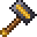
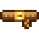
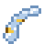
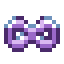

# Nórdicos

<!-- Generado por tools/model-gen/make_codex.py desde los datos del mod. No editar a mano. -->

Casi todos los tesoros de los dioses nórdicos los forjaron los enanos: el martillo de Thor, la lanza de Odín, su anillo y la cinta que ató a Fenrir.  
Están donde su mito calza: el frío del norte, las minas de los enanos y las pruebas de los héroes.

| | Reliquia | Espacio | Rareza | Dónde |
|---|---|---|---|---|
|  | [Mjölnir](#mjolnir) | mano (arma) | épica | Bóvedas ominosas de cámaras de desafío: 2 % por cofre |
|  | [Járngreipr](#jarngreipr) | guantes | rara | Minas abandonadas: 3 % por cofre |
|  | [Megingjörð](#megingjord) | cinturón | rara | Iglús: 6 % por cofre |
|  | [Gungnir](#gungnir) | mano (arma) | épica | Ciudades del End: 3 % por cofre |
|  | [Draupnir](#draupnir) | anillo | épica | Tesoros enterrados: 6 % por cofre |
|  | [Gjallarhorn](#gjallarhorn) | mano | épica | Puestos de saqueadores: 4 % por cofre |
|  | [Gleipnir](#gleipnir) | mano | épica | Ciudades antiguas: 3 % por cofre |
|  | [Manzanas de Iðunn](#idunn-apples) | mano | épica | Casas de aldeas nevadas: 4 % por cofre |

## Mjölnir

**Espacio:** mano (arma) · **Rareza:** épica

- Mantén clic derecho y suelta para lanzarlo: vuela hasta 24 bloques, golpea y vuelve a ti
- En tormenta, donde golpea cae un rayo

*Set de Thor (Mjölnir, Járngreipr y Megingjörð):* Cada martillo lanzado llama un rayo donde golpea, con o sin tormenta

**Mito.** El martillo de Thor lo forjaron los enanos Brokkr y Sindri. Loki, convertido en tábano, picó a Brokkr en el párpado y por eso el mango quedó corto.  
Mjölnir nunca falla y siempre vuelve a la mano de Thor.

**Dónde encontrarla.** **Bóvedas ominosas de cámaras de desafío**: 2 % por cofre

## Járngreipr

**Espacio:** guantes · **Rareza:** rara

- Puños de hierro: +3 de daño sin arma
- Los rayos no te hacen daño

*Set de Thor (Mjölnir, Járngreipr y Megingjörð):* Cada martillo lanzado llama un rayo donde golpea, con o sin tormenta

**Mito.** Los guantes de hierro de Thor. Los necesitaba para empuñar a Mjölnir, que ardía al rojo cuando volvía de un lanzamiento.

**Dónde encontrarla.** **Minas abandonadas**: 3 % por cofre

## Megingjörð

**Espacio:** cinturón · **Rareza:** rara

- Fuerza divina: +25% de daño cuerpo a cuerpo y 50% menos retroceso al recibir golpes

*Set de Thor (Mjölnir, Járngreipr y Megingjörð):* Cada martillo lanzado llama un rayo donde golpea, con o sin tormenta

**Mito.** El cinturón de fuerza de Thor: al ceñírselo, su fuerza divina se duplicaba.

**Dónde encontrarla.** **Iglús**: 6 % por cofre

## Gungnir

**Espacio:** mano (arma) · **Rareza:** épica

- Nunca falla: al lanzarla busca al mob más cercano a donde apuntas (hasta 32 bloques) y vuelve a ti

**Mito.** La lanza de Odín, forjada por los hijos de Ivaldi. Nunca falla su blanco.  
Odín la lanzó sobre el ejército de los vanir para comenzar la primera guerra del mundo.

**Dónde encontrarla.** **Ciudades del End**: 3 % por cofre

## Draupnir

**Espacio:** anillo · **Rareza:** épica

- Al amanecer de cada 9ª noche que lo llevas puesto, gotean 8 lingotes de oro

**Mito.** El anillo de oro de Odín, forjado por los mismos enanos que Mjölnir. Cada nueve noches goteaban de él ocho anillos iguales.

**Dónde encontrarla.** **Tesoros enterrados**: 6 % por cofre

## Gjallarhorn

**Espacio:** mano · **Rareza:** épica

- Mantén clic derecho 2 s para tocarlo: tú y tus aliados a 32 bloques, Fuerza I y Velocidad I 60 s
- Los hostiles a 64 bloques brillan 10 s
- Recarga: 5 min

**Mito.** El cuerno de Heimdall, el guardián del puente Bifröst que todo lo ve y todo lo oye.  
Su toque se oye en los nueve mundos y anunciará el Ragnarök.

**Dónde encontrarla.** **Puestos de saqueadores**: 4 % por cofre

## Gleipnir

**Espacio:** mano · **Rareza:** épica

- Clic derecho a un mob: queda atado 6 s
- No se mueve ni ataca (no los jefes)
- Recarga: 30 s

**Mito.** La única atadura que pudo con el lobo Fenrir. La hicieron los enanos con seis cosas que no existen: el ruido de los pasos del gato, la barba de la mujer, las raíces de la montaña, los tendones del oso, el aliento del pez y la saliva del pájaro.  
Era fina y suave como una cinta de seda.

**Dónde encontrarla.** **Ciudades antiguas**: 3 % por cofre

## Manzanas de Iðunn

**Espacio:** mano · **Rareza:** épica

- Come una: Regeneración II 10 s y Absorción I 2 min, y te quita veneno, marchitamiento, lentitud, debilidad y hambre
- Hasta 3 manzanas; crece una cada día

**Mito.** La diosa Iðunn guardaba en una cesta las manzanas que mantenían jóvenes a los dioses.  
Cuando el gigante Þjazi la raptó, los dioses empezaron a envejecer.

**Dónde encontrarla.** **Casas de aldeas nevadas**: 4 % por cofre

## Set de Thor

Set de Thor (Mjölnir, Járngreipr y Megingjörð): Cada martillo lanzado llama un rayo donde golpea, con o sin tormenta

**Mito.** Thor no podía empuñar a Mjölnir sin sus guantes de hierro, y con el cinturón de fuerza su poder se duplicaba: los tres juntos son el dios del trueno.
