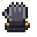
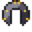
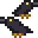
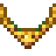
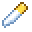
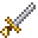
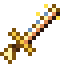
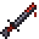
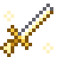

# Nórdicos

<!-- Generado por tools/model-gen/make_codex.py desde los datos del mod. No editar a mano. -->

Casi todos los tesoros de los dioses nórdicos los forjaron los enanos: el martillo de Thor, la lanza de Odín, su anillo y la cinta que ató a Fenrir.  
Están donde su mito calza: el frío del norte, las minas de los enanos y las pruebas de los héroes.

| | Reliquia | Espacio | Rareza | Dónde |
|---|---|---|---|---|
|  | [Mjölnir](#mjolnir) | mano (arma) | épica | Bóvedas ominosas de cámaras de desafío: 4 % por cofre |
|  | [Járngreipr](#jarngreipr) | guantes | rara | Minas abandonadas: 6 % por cofre |
|  | [Megingjörð](#megingjord) | cinturón | rara | Iglús: 12 % por cofre |
|  | [Gungnir](#gungnir) | mano (arma) | épica | Ciudades del End: 6 % por cofre |
|  | [Draupnir](#draupnir) | anillo | épica | Tesoros enterrados: 12 % por cofre |
|  | [Gjallarhorn](#gjallarhorn) | mano | épica | Puestos de saqueadores: 8 % por cofre |
|  | [Gleipnir](#gleipnir) | mano | épica | Ciudades antiguas: 6 % por cofre |
|  | [Manzanas de Iðunn](#idunn-apples) | mano | épica | Casas de aldeas nevadas: 8 % por cofre |
|  | [Herradura de Sleipnir](#sleipnir-horseshoe) | mano | épica | Casas de aldeas de sabana: 8 % por cofre |
|  | [Huginn y Muninn](#odin-ravens) | mano | épica | Ciudades del End: 6 % por cofre |
|  | [Brísingamen](#brisingamen) | collar | épica | Minas abandonadas: 4 % por cofre |
|  | [Skíðblaðnir](#skidbladnir) | mano | épica | Provisiones de naufragios: 8 % por cofre |
|  | [Cabeza de Mímir](#mimir-head) | mano secundaria | épica | Cruces de la fortaleza: 8 % por cofre |
|  | [Andvaranaut](#andvaranaut) | anillo | épica | Tesoros de bastiones: 6 % por cofre |
|  | [Óðrerir](#odrerir) | mano | rara | Casas de aldeas de taiga: 6 % por cofre |
|  | [Gram](#gram) | mano (arma) | épica | Armeros de aldea: 4 % por cofre |
|  | [Tyrfing](#tyrfing) | mano (arma) | épica | Tesoros de bastiones: 4 % por cofre |
|  | [Dáinsleif](#dainsleif) | mano (arma) | épica | Ciudades antiguas: 6 % por cofre |
|  | [Espada de Freyr](#freyr-sword) | espalda | épica | Mansiones del bosque: 6 % por cofre |
|  | [Manto de plumas de halcón](#falcon-cloak) | espalda | épica | Casas de aldeas de taiga: 6 % por cofre |
|  | [Dardo de muérdago](#mistletoe-dart) | mano (arma) | épica | Mansiones del bosque: 6 % por cofre |

## Mjölnir

**Espacio:** mano (arma) · **Rareza:** épica

- Mantén clic derecho y suelta para lanzarlo: vuela hasta 24 bloques, golpea y vuelve a ti
- En tormenta, donde golpea cae un rayo

*Set de Thor (Mjölnir, Járngreipr, Megingjörð)* Cada martillo lanzado llama un rayo donde golpea, con o sin tormenta +30 % de daño de Mjölnir lanzado y de sus rayos

**Mito.** El martillo de Thor lo forjaron los enanos Brokkr y Sindri. Loki, convertido en tábano, picó a Brokkr en el párpado y por eso el mango quedó corto.  
Mjölnir nunca falla y siempre vuelve a la mano de Thor.

**Dónde encontrarla.** **Bóvedas ominosas de cámaras de desafío**: 4 % por cofre

## Járngreipr

**Espacio:** guantes · **Rareza:** rara

- Puños de hierro: +3 de daño sin arma
- Los rayos no te hacen daño

*Set de Thor (Mjölnir, Járngreipr, Megingjörð)* Cada martillo lanzado llama un rayo donde golpea, con o sin tormenta +30 % de daño de Mjölnir lanzado y de sus rayos

**Mito.** Los guantes de hierro de Thor. Los necesitaba para empuñar a Mjölnir, que ardía al rojo cuando volvía de un lanzamiento.

**Dónde encontrarla.** **Minas abandonadas**: 6 % por cofre

## Megingjörð

**Espacio:** cinturón · **Rareza:** rara

- Fuerza divina: +25% de daño cuerpo a cuerpo y 50% menos retroceso al recibir golpes

*Set de Thor (Mjölnir, Járngreipr, Megingjörð)* Cada martillo lanzado llama un rayo donde golpea, con o sin tormenta +30 % de daño de Mjölnir lanzado y de sus rayos

**Mito.** El cinturón de fuerza de Thor: al ceñírselo, su fuerza divina se duplicaba.

**Dónde encontrarla.** **Iglús**: 12 % por cofre

## Gungnir

**Espacio:** mano (arma) · **Rareza:** épica

- Nunca falla: al lanzarla busca al mob más cercano a donde apuntas (hasta 32 bloques) y vuelve a ti

**Mito.** La lanza de Odín, forjada por los hijos de Ivaldi. Nunca falla su blanco.  
Odín la lanzó sobre el ejército de los vanir para comenzar la primera guerra del mundo.

**Dónde encontrarla.** **Ciudades del End**: 6 % por cofre

## Draupnir

**Espacio:** anillo · **Rareza:** épica

- Al amanecer de cada 9ª noche que lo llevas puesto, gotean 8 lingotes de oro

**Mito.** El anillo de oro de Odín, forjado por los mismos enanos que Mjölnir. Cada nueve noches goteaban de él ocho anillos iguales.

**Dónde encontrarla.** **Tesoros enterrados**: 12 % por cofre

## Gjallarhorn

**Espacio:** mano · **Rareza:** épica

- Mantén clic derecho 2 s para tocarlo: tú y tus aliados a 32 bloques, Fuerza I y Velocidad I 60 s
- Los hostiles a 64 bloques brillan 10 s
- Recarga: 5 min

**Mito.** El cuerno de Heimdall, el guardián del puente Bifröst que todo lo ve y todo lo oye.  
Su toque se oye en los nueve mundos y anunciará el Ragnarök.

**Dónde encontrarla.** **Puestos de saqueadores**: 8 % por cofre

## Gleipnir

**Espacio:** mano · **Rareza:** épica

- Clic derecho a un mob: queda atado 15 s, sin moverse ni atacar
- Mientras está atado recibe +40% de daño
- A los jefes no los ata: los frena mucho durante 5 s
- Recarga: 20 s

**Mito.** La única atadura que pudo con el lobo Fenrir. La hicieron los enanos con seis cosas que no existen: el ruido de los pasos del gato, la barba de la mujer, las raíces de la montaña, los tendones del oso, el aliento del pez y la saliva del pájaro.  
Era fina y suave como una cinta de seda.

**Dónde encontrarla.** **Ciudades antiguas**: 6 % por cofre

## Manzanas de Iðunn

**Espacio:** mano · **Rareza:** épica

- Come una: Regeneración II 10 s y Absorción I 2 min, y te quita veneno, marchitamiento, lentitud, debilidad y hambre
- Hasta 3 manzanas; crece una cada día

**Mito.** La diosa Iðunn guardaba en una cesta las manzanas que mantenían jóvenes a los dioses.  
Cuando el gigante Þjazi la raptó, los dioses empezaron a envejecer.

**Dónde encontrarla.** **Casas de aldeas nevadas**: 8 % por cofre

## Herradura de Sleipnir

**Espacio:** mano · **Rareza:** épica

- Clic derecho: llamas a Sleipnir y lo montas
- Muy rápido, salta alto, sin daño de caída y galopa sobre el agua
- Al bajarte vuelve a Asgard a los 3 s
- Si muere, vuelve en 5 min

**Mito.** Sleipnir, el caballo de ocho patas de Odín, era el más rápido de todos. Galopaba por el aire y sobre el mar.  
Hermóðr lo montó para bajar hasta Hel a pedir por Balder.

**Dónde encontrarla.** **Casas de aldeas de sabana**: 8 % por cofre

## Huginn y Muninn

**Espacio:** mano · **Rareza:** épica

- Clic derecho: salen Huginn y Muninn; otra vez, vuelven con Odín
- Se posan cerca de ti y te miran; mientras están afuera, los hostiles a 32 bloques brillan
- Agachado: Muninn te recuerda dónde moriste y dónde está tu cama

**Mito.** Los cuervos de Odín, Pensamiento y Memoria. Cada mañana vuelan por todo el mundo y al volver le cuentan al oído todo lo que vieron.

**Dónde encontrarla.** **Ciudades del End**: 6 % por cofre

## Brísingamen

**Espacio:** collar · **Rareza:** épica

- Los cultivos y las crías a 8 bloques crecen más rápido
- Al matar a un hostil recuperas 1 corazón

**Mito.** El collar de la diosa Freyja, forjado por cuatro enanos.  
Freyja era diosa del amor y la fertilidad, y recibía en su salón a la mitad de los guerreros caídos en batalla.

**Dónde encontrarla.** **Minas abandonadas**: 4 % por cofre

## Skíðblaðnir

**Espacio:** mano · **Rareza:** épica

- Clic derecho mirando al agua: despliegas un bote
- Al bajarte se pliega solo. Viento a favor: +60% de velocidad

**Mito.** El barco del dios Freyr, hecho por los hijos de Ivaldi. Cabían todos los dioses con sus armas, siempre tenía viento a favor y se plegaba como un pañuelo para llevarlo en el bolsillo.

**Dónde encontrarla.** **Provisiones de naufragios**: 8 % por cofre

## Cabeza de Mímir

**Espacio:** mano secundaria · **Rareza:** épica

- Clic derecho: le preguntas a Mímir por el tesoro más valioso a 24 bloques (debris, diamante, cofre sin abrir…)
- Te responde una vez y te guía con una estela de luz 30 s; brillan los minerales valiosos a 8 bloques y los cofres sin abrir
- Recarga: 5 s
- Mientras lo sostienes, te avisa cuando un creeper empieza a explotar

**Mito.** Mímir era el más sabio de los dioses. Cuando los vanir lo decapitaron, Odín untó su cabeza con hierbas para que no se pudriera y le cantó encantamientos.  
Así la cabeza hablaba y le contaba a Odín lo que nadie más sabía.

**Dónde encontrarla.** **Cruces de la fortaleza**: 8 % por cofre

## Andvaranaut

**Espacio:** anillo · **Rareza:** épica

- El mineral de oro suelta el doble y los piglins te dan el doble en los trueques
- Maldición: 2 corazones menos de vida máxima y los hostiles cercanos te prefieren a ti

**Mito.** El anillo del enano Andvari, que hacía crecer el oro. Cuando Loki se lo robó, Andvari lo maldijo: traería la ruina a todos sus dueños.  
Así fue con Hreidmar, con Fafnir y con Sigurd.

**Dónde encontrarla.** **Tesoros de bastiones**: 6 % por cofre

## Óðrerir

**Espacio:** mano · **Rareza:** rara

- Bébelo: +5 niveles y Prisa I durante 5 min
- No se gasta: una vez por día

**Mito.** El hidromiel de la poesía, hecho con la sangre del sabio Kvasir: quien lo bebía se volvía poeta o erudito.  
Odín se lo robó a los gigantes convertido en águila.

**Dónde encontrarla.** **Casas de aldeas de taiga**: 6 % por cofre

## Gram

**Espacio:** mano (arma) · **Rareza:** épica

- Pasiva: cada 2 golpes, el siguiente es una estocada con +50% de daño
- La estocada hace el doble contra mobs de 100 de vida o más (dragón, Wither, devastador, gólem, Warden)

**Mito.** Odín clavó una espada en el árbol Barnstokkr y solo Sigmund pudo sacarla. El herrero Regin reforjó sus pedazos para Sigurd: Gram partió el yunque de un golpe.  
Con ella Sigurd mató al dragón Fáfnir desde un foso, hiriéndolo desde abajo.

**Dónde encontrarla.** **Armeros de aldea**: 4 % por cofre

## Tyrfing

**Espacio:** mano (arma) · **Rareza:** épica

- Nunca falla: todos tus golpes son críticos (+50% de daño)
- Brilla como el fuego
- Maldición: cada golpe que no mata te quita medio corazón

**Mito.** El rey Svafrlami obligó a los enanos Dvalinn y Durinn a forjarle una espada que no fallara nunca: brillaba como el fuego y cortaba hierro como tela.  
Pero la maldijeron: cada vez que se desenvainara tendría que matar a un hombre.

**Dónde encontrarla.** **Tesoros de bastiones**: 4 % por cofre

## Dáinsleif

**Espacio:** mano (arma) · **Rareza:** épica

- Heridas que no sanan: el golpeado no se cura ni regenera por 10 s y sangra medio corazón por segundo durante 4 s

**Mito.** La espada del rey Högni en la batalla de los Hjaðningar, que no termina nunca: cada noche la valquiria Hildr revive a los caídos.  
La forjaron los enanos y sus heridas nunca sanaban.

**Dónde encontrarla.** **Ciudades antiguas**: 6 % por cofre

## Espada de Freyr

**Espacio:** espalda · **Rareza:** épica

- Va envainada en la espalda. En combate (o con un hostil persiguiéndote a 12 bloques) sale y pelea sola
- 5 de daño por tajo; +50% contra mobs grandes
- +50% si tienes 30 niveles o más («si su portador es sabio»)
- No se puede herir. A los 5 s sin combate vuelve a la vaina

**Mito.** Freyr, el señor del sol de verano y de Álfheimr, tenía una espada que peleaba sola contra los gigantes si la llevaba alguien sabio.  
Se la dio a Skírnir para pedir la mano de Gerðr; por eso en el Ragnarök enfrentará a Surtr solo con un asta de ciervo.

**Dónde encontrarla.** **Mansiones del bosque**: 6 % por cofre

## Manto de plumas de halcón

**Espacio:** espalda · **Rareza:** épica

- Tecla del manto (V por defecto, en Controles): te vuelves halcón 20 s, con su tamaño y su forma
- Solo vuelas: no atacas, no usas, no rompes, no pones ni recoges nada. La misma tecla te vuelve humano; si te golpean, también (y caes lento)
- Recarga: 90 s

**Mito.** Freyja tenía un manto de plumas de halcón que convertía en halcón a quien se lo ponía.  
Loki se lo pidió prestado para buscar el martillo que le robaron a Thor y para rescatar a Iðunn, que llevó de vuelta a Asgard convertida en nuez.

**Dónde encontrarla.** **Casas de aldeas de taiga**: 6 % por cofre

## Dardo de muérdago

**Espacio:** mano (arma) · **Rareza:** épica

- Mantén clic derecho y suelta para lanzarlo; queda clavado donde cae hasta que lo recojas (sin recarga)
- 16 de daño que ignora armadura, Resistencia y encantamientos de protección; el doble contra jefes

**Mito.** Frigg hizo jurar a todas las cosas que no dañarían a su hijo Baldr; solo dejó fuera al muérdago, que le pareció demasiado joven.  
Loki, disfrazado de anciana, le sacó el secreto, hizo un dardo de muérdago y se lo puso en la mano al ciego Höðr, que lo lanzó y mató a Baldr.

**Dónde encontrarla.** **Mansiones del bosque**: 6 % por cofre

## Set de Thor

Set de Thor (Mjölnir, Járngreipr, Megingjörð) Cada martillo lanzado llama un rayo donde golpea, con o sin tormenta +30 % de daño de Mjölnir lanzado y de sus rayos

**Mito.** Thor no podía empuñar a Mjölnir sin sus guantes de hierro, y con el cinturón de fuerza su poder se duplicaba: los tres juntos son el dios del trueno.
